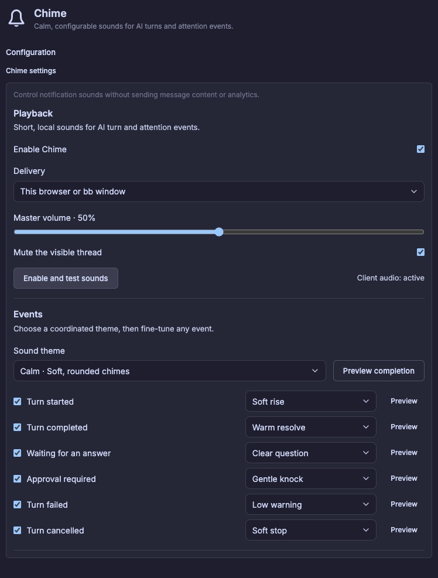

# Chime

Chime is an owned local Omnyo plugin that plays calm, configurable notification sounds when AI turns start, finish, fail, pause for a question, or request approval.

This private fork retains the MIT-licensed implementation and sounds from [gtramontina/bb-plugin-chime](https://github.com/gtramontina/bb-plugin-chime), with local completion repairs. Its plugin ID is `chime-local`. The Mac coordinator runs it from a package built from committed source in this folder, under `~/.omnyo/plugins/local-builds/chime-local/<build>`. External Chime (`chime`) stays disabled, and its updates cannot replace this package.

## Settings



## Features

- Six independently configurable events: started, completed, question, approval, failed, and best-effort cancellation.
- Client-local audio in Omnyo desktop windows and browser clients. When a sound plays in the visible app, its chat row briefly lights up in the sidebar.
- Best-effort leader election prevents duplicate sounds across tabs on the same origin.
- Optional macOS server playback through `/usr/bin/afplay`.
- Omnyo (the default, with alternative completed, approval and failed sounds), Velvet, Calm, Glass, Wood, and Minimal sound themes with per-event customization.
- Master volume, visible-thread muting, and a project mute denylist.
- One-second storm suppression prioritizes questions, approvals, and failures.
- Events older than five seconds are discarded after reconnects.
- No telemetry, message content, error text, or durable event history.

## Install as a runtime package

Commit every change first: packaging refuses uncommitted work in this folder. Then run:

```sh
pnpm package:runtime
pnpm install:runtime -- --machine <host-id>
```

`package:runtime` builds the plugin and stages the server, app, committed assets, README and license as one hashed package. `install:runtime` has the coordinator move that package into `~/.omnyo/plugins/local-builds/chime-local/<build>`, checks every file's SHA-256 there, installs it in place of the previous Chime build and checks that every sound is served from it. Settings and sound preferences are kept. Both steps record their result in `docs/evidence/`. Do not install this folder directly: the plugin would then run live from the working tree.

Open **Settings → Plugins → Chime**, choose **Enable and test sounds**, then save your preferences.

## Browser audio

Browsers require a user gesture before allowing audio. Chime attempts to unlock audio on the first pointer or keyboard interaction, and the settings page reports whether playback is active or blocked.

Leader election is scoped to one browser origin. A local Omnyo window and a remote Omnyo client use different origins, so both may sound. This is intentional: sound follows the device where each client is open.

## Server playback

Server playback is available when Omnyo runs on macOS and `/usr/bin/afplay` exists. It plays on the server machine, not necessarily the machine displaying a remote Omnyo client. Client playback remains the portable default.

## Event semantics

- **Started** corresponds to a thread entering its active state for a turn.
- **Completed** requires a successful, unread turn and no remaining work. Chime reads the sidebar’s activity counts, including background commands, workflows, plan mode and goals, and suppresses queued sends or pending input. When Needs You is enabled, its callback waits, owned workflow workers, open Decisions and green-highlight setting also apply. Client and server playback recheck the exact turn after storm suppression. Remaining background work delays completion until it finishes; hidden helper threads stay silent. Unavailable state checks suppress sound and log the failure.
- **Question** and **approval** are detected from pending interactions and deduplicated by interaction ID. **Question** also plays once for each Omnyo question, optional or required, opened in the last minute, including one asked while the turn keeps running.
- **Failed** corresponds to the thread error transition; error text is never placed in Chime's queue.
- **Cancelled** requires the latest `system/thread/interrupted` event to have reason `manual-stop`. Missing history, other interruptions and verification failures never imply completion; verification failures are logged.

## Local maintenance

Edit this folder, run the checks below, commit, then package and install as described above. Do not enable external Chime (`chime`) while this plugin (`chime-local`) is running. Sound settings were transferred through each plugin’s public configuration RPC and remain separate. Keep the original MIT attribution; publishing this fork outside the private plugins repository requires separate authorization.

## Development

```sh
npm test
npm run typecheck
npm run build
npm run smoke:live
```

The live smoke test expects Omnyo at `http://127.0.0.1:38886`; override it with `CHIME_OMNYO_BASE_URL`.

The Calm, Glass, Wood, and Minimal sounds are original assets synthesized and generated deterministically by `scripts/generate-sounds.mjs`, and are distributed under this repository's MIT license. That script does not write the Velvet or Omnyo sounds.

The five Omnyo sounds are the default completed, question, approval, failed and cancelled sounds, and six more are alternatives listed under Omnyo in each event's sound picker. Started keeps the Calm `soft-rise`. Started and cancelled are off by default; turn them on per event in settings. The project owner made all eleven for Omnyo; the MIT license does not cover them. Each was decoded from 48 kHz MP3 to 16-bit, 44.1 kHz stereo WAV, cut where its tail falls below −60 dB with a 20 ms fade-out, and normalized.

The three Velvet sounds were the default completed, question/approval and failed sounds until the Omnyo sounds replaced them. The project owner made them for Omnyo; the MIT license does not cover them. Each was decoded from 48 kHz MP3 to 16-bit, 44.1 kHz stereo WAV, cut where its tail falls below −60 dB with a 20 ms fade-out, and normalized. Started and cancelled keep the Calm `soft-rise` and `soft-stop`.

Every sound in `assets/sounds` is normalized to the same loudness: a maximum momentary loudness of −17.8 LUFS, measured with the clip padded to 0.5 s so short sounds are judged fairly, under a −1 dBTP ceiling. After regenerating or replacing a sound, run `pnpm normalize:sounds` (needs `python3` and `ffmpeg`).

| Sound                                   | Source file                                                 | Edit                                                                                                           |
| --------------------------------------- | ----------------------------------------------------------- | -------------------------------------------------------------------------------------------------------------- |
| `velvet-resolve` (completed)            | `Velvety_smooth_notif_#2-1795297947264.mp3`                 | Keeps 0–1.50 s, then a 20 ms fade-out.                                                                         |
| `velvet-attention` (question, approval) | `Velvety_smooth_notif_#3-1795297947265.mp3`                 | Keeps 0.10–2.16 s, dropping leading silence, then a 20 ms fade-out.                                            |
| `velvet-warning` (failed)               | `Velvety_smooth_notif_#1-1795297947266.mp3`                 | Keeps 0–2.33 s, then a 20 ms fade-out.                                                                         |
| `omnyo-resolve` (completed)             | `turn-completed.mp3`                                        | Keeps 0–1.99 s, then a 20 ms fade-out.                                                                         |
| `omnyo-question` (question)             | `waiting-for-answer.mp3`                                    | Keeps 0.10–2.14 s, dropping leading silence, then a 20 ms fade-out.                                            |
| `omnyo-approval` (approval)             | `approval-required.mp3`                                     | Keeps 0–1.86 s, dropping a 14 ms blip after the tail, then a 20 ms fade-out.                                   |
| `omnyo-warning` (failed)                | `turn-failed.mp3`                                           | Keeps 0–2.37 s, then a 20 ms fade-out.                                                                         |
| `omnyo-stop` (cancelled)                | `turn-cancelled.mp3`                                        | Keeps 0–1.58 s, then a 20 ms fade-out.                                                                         |
| `omnyo-resolve-b` (alternative)         | `alternatives/turn-completed5.mp3`                          | Keeps 0–1.95 s, then a 20 ms fade-out.                                                                         |
| `omnyo-resolve-c` (alternative)         | `alternatives/turn-completed-6.mp3`                         | Keeps 0–2.21 s, then a 20 ms fade-out.                                                                         |
| `omnyo-resolve-d` (alternative)         | `alternatives/turn-complet233ed.mp3`                        | Keeps 0–1.48 s, then a 20 ms fade-out.                                                                         |
| `omnyo-resolve-e` (alternative)         | `alternatives/turn-comp222leted.mp3`                        | Keeps the full 2.00 s, with a 20 ms fade-out.                                                                  |
| `omnyo-approval-b` (alternative)        | `alternatives/approval-required-2.mp3`                      | Keeps 0–2.20 s, then a 20 ms fade-out.                                                                         |
| `omnyo-warning-b` (alternative)         | `alternatives/turn-failed-2.mp3`                            | Keeps 0–2.31 s, then a 20 ms fade-out.                                                                         |

## License

MIT
